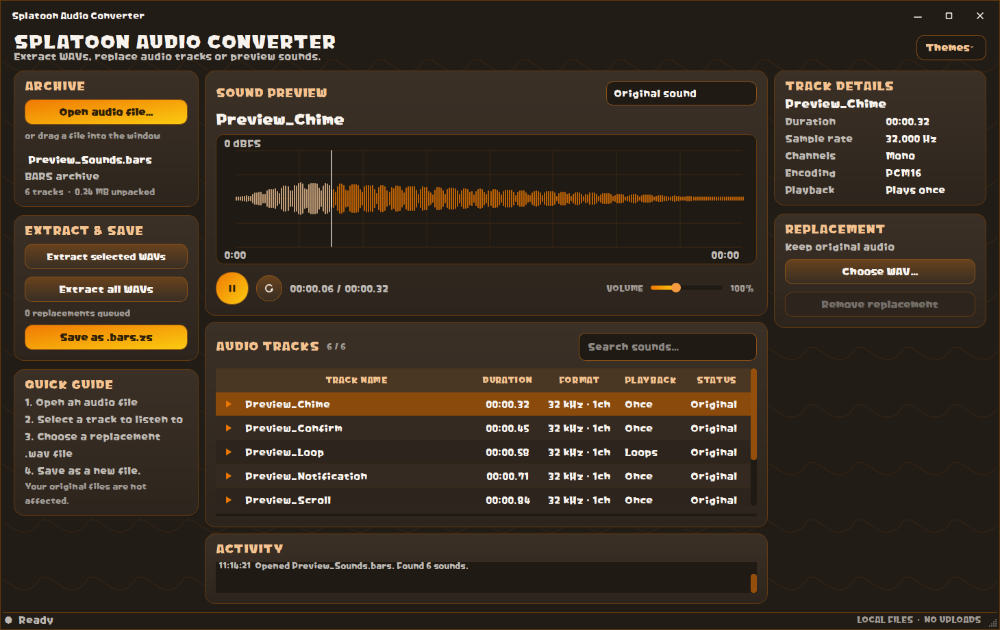

# Splatoon Audio Converter

Extract WAVs, replace audio tracks or preview sounds.

The supported app is the original **v2.4.2 Qt interface**, including its supplied
font, rounded controls, waveform, title bar, themes and audio engine. The native
v3 rewrite is withdrawn from the recommended download; `native-app/` is retained
only as an unused experiment. It is not the default build.

[Download smaller original version](https://github.com/qrazyi/splatoon-audio-converter/releases/download/v2.4.2/Splatoon-Audio-Converter-v2.4.2-smaller-win-x64.zip)
· [Issues](https://github.com/qrazyi/splatoon-audio-converter/issues)



## Smaller package, same application

The smaller v2.4.2 package is about **45 MB to download / 116 MB extracted**,
compared with the previous 84 MB ZIP / 212 MB folder. This is a packaging change,
not a UI rewrite or a new audio engine. It omits unused video/PDF/QML/virtual
keyboard/3D components and orphaned ICU data. Python, NumPy, Qt Widgets, the
custom font and the Windows PCM audio backend remain included.

The repack script preserves the baseline folder and verifies that every retained
file, including the EXE, is byte-identical. The original v2.4.2 folder is never
modified. Newly built releases use the same packaging exclusions.

## Run / use

Extract the **whole ZIP**, then run **Splatoon Audio Converter.exe**. Keep
`_internal` beside it. Windows 10/11 x64 is supported. No Python, Switch Toolbox
or external media player needs to be installed. The Nintendo helpers need .NET
Framework 4.8, normally already present on Windows. Required runtime DLLs and
license notices are included.

1. Open an audio file
2. Select a track to listen to
3. Choose a replacement .wav file
4. Save as a new file.

Your original files are not affected.

Inputs: `.bars`, `.bars.zs`, `.bwav`, `.bwav.zs`, `.bfstm`, `.bfstm.zs`.
Replacement: mono/stereo 16-bit PCM WAV. Sample rate/channels are matched on
export, loops retain their relative position, and extensions are added once.
Extraction creates WAVs only, with no manifest or JSON sidecars. Multichannel
music previews its first stereo pair; extracted WAVs retain all channels.
Replacement of multichannel music is not supported. Older FWAV/FSTP archives
remain preview/extract-only.

Preview volume is 0–300%, using the existing independent audio worker and smooth
gain ramps. Loud sounds can clip. The restart button immediately replays even
when paused. Click the waveform to seek. Shortcuts: Ctrl+O open, Space play/pause,
Ctrl+R restart, Ctrl+Shift+S save a new file.

Themes are unchanged: Aqua, Beige, Dark Aero, Dorfic (default), Eco. No new UI
design is applied. The app works offline, with no updater, uploads or GitHub button.

## Develop / package

Use Python 3.12 on Windows:

```powershell
python -m pip install . pyinstaller
python scripts/build_native.py
$env:PYTHONPATH = "src"
python -m unittest discover -s tests -p "test_*.py" -v
python tests/smoke_ui.py
python tests/smoke_playback.py
python -m PyInstaller --noconfirm "Splatoon Audio Converter.spec"
python scripts/smoke_frozen.py
python scripts/check_privacy.py dist
python scripts/package_release.py
python scripts/smoke_frozen.py --zip dist/Splatoon-Audio-Converter-win-x64.zip
```

To repack an existing working folder without rebuilding its EXE:

```powershell
python scripts/repack_original.py "path/to/working/folder" "path/to/new/folder"
```

The destination must not exist. The script copies only retained files and
verifies the baseline and copies by SHA-256. Development tests use generated
sounds, not game assets. Public packaging excludes personal paths, settings,
logs, private fonts, debug symbols and example game audio. Source ZIPs exclude
build folders, caches and the unused native experiment.

## Credits / licensing

UI arrangement inspired by [HoianViewer by nvnprogram](https://github.com/nvnprogram/HoianViewer).
No HoianViewer code or assets are copied. The supplied NinDev-Treasure font is
included under its original terms, separately from the app's MIT license.
See [third-party notices](THIRD_PARTY_NOTICES.md) and [font notes](fonts/README.md).
Keep required notices under `_internal/licenses` when redistributing.

Application code: [MIT](LICENSE). Not affiliated with or endorsed by Nintendo.
