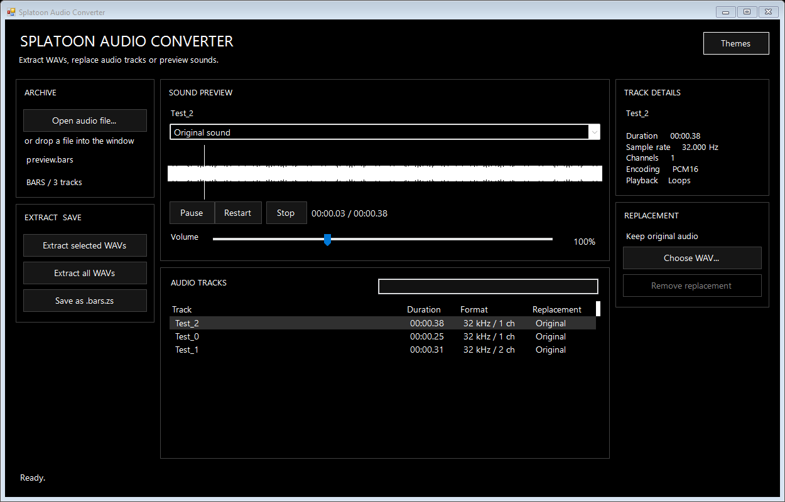

# Splatoon Audio Converter

Extract WAVs, replace audio tracks or preview sounds.

Version 3 rebuilds the desktop app using Windows Forms, a lightweight waveform
renderer and Windows audio output. The portable folder is about **1 MB**, not
80 MB. Both the download and extracted app are checked against a **20 MiB limit**.
No Python, NumPy, Qt, FFmpeg or web-browser runtime is bundled or required.

[Download](https://github.com/qrazyi/splatoon-audio-converter/releases/latest)
· [Report an issue](https://github.com/qrazyi/splatoon-audio-converter/issues)


## Run

Extract the entire ZIP and open **Splatoon Audio Converter.exe**. Keep its small
`_internal` folder beside it. There is no installer, updater, GitHub button,
telemetry or network access. The app does not need administrator privileges.

Windows 10/11 **x64** with **.NET Framework 4.8** is required. It is already part
of most current Windows installations; install Microsoft's runtime if missing.
The download relies on that Windows runtime to stay small. It is not a
self-contained runtime bundle or a macOS/Linux application.

## Use

1. Open an audio file
2. Select a track to listen to
3. Choose a replacement .wav file
4. Save as a new file.

Your original files are not affected.

Supported inputs: `.bars`, `.bars.zs`, `.bwav`, `.bwav.zs`, `.bfstm`, `.bfstm.zs`.
Drag/drop, track filtering, duration/channel details, waveform seeking,
play/pause, immediate restart, extraction and replacement previews are included.
Extraction creates **WAVs only**, never a manifest or sidecar JSON.

Replacement WAVs must be uncompressed **16-bit PCM**, mono or stereo. Sample
rate and channel count are matched automatically. Existing loops retain their
relative position. Preview volume supports **0–300%**, with smooth gain changes
on a separate audio worker; it does not change saved/extracted audio. Boosting
loud tracks can clip. Restart immediately starts playing again, even if paused.

BARS saves as `.bars.zs`. Standalone BWAV/BFSTM retains its format/compression.
The extension is added once, even if the selected name already has it. The
original input cannot be overwritten. Other existing output files require
confirmation; saves are built and validated before replacing the destination.

Multichannel audio previews its **first stereo pair**; extraction retains every
channel. Tracks with more than two channels, old FWAV/FSTP entries and short
prefetches are preview/extract-only. Their untouched bytes are kept when other
editable tracks in the archive are replaced. Prefetches contain only the opening
portion of a sound. BWAV PCM16 and DSP-ADPCM are supported, not BWAV Opus.
Files/decompressed archives over 512 MB are rejected.

Shortcuts: **Ctrl+O** open, **Space** play/pause, **Ctrl+R** restart,
**Ctrl+Shift+S** save a new game-audio file.

## Themes

Themes are alphabetically ordered: **Aqua, Beige, Dark Aero, Dorfic, Eco, Legacy**.
Dorfic remains the default. Normal themes keep the supplied interface font,
rounded controls and the existing accent colors. Native Windows window controls
handle resizing/maximizing; title-bar colors apply where supported by Windows.

**Legacy** uses a plain **black background, white text, system font, flat controls,
no gradients and no Quick Guide**. It restores a simple original-style workbench
without installing a second app. It does not remove any audio functionality.



Only the theme name is remembered in the current user's registry settings.
Audio paths, track lists, volume preferences and recent files are not saved.

## Build / test

The native source is in `native-app/`. The earlier Python v2 implementation stays
in this repository for reference; it is **not shipped in v3**. No NuGet install or
Python setup is needed for native builds. Use Windows PowerShell with the .NET
Framework C# compiler:

```powershell
.\native-app\build.ps1
.\native-app\test.ps1 -SkipBuild
.\native-app\package.ps1
.\native-app\smoke.ps1
```

Output: `native-app/dist/`. The source ZIP contains the native source, tests,
build scripts and the small required dependencies, not old runtime bundles.
Tests generate their own sounds; no game audio is included. Hardware playback
checks run if an output endpoint exists; deterministic playback tests also run
without hardware. Fresh-ZIP checks remove development/Python/Qt paths from the
process environment and exercise every input extension plus multichannel music.

The included codec is built with a static C runtime, so end users do not need a
separate Visual C++ redistributable. To rebuild that dependency from its pinned,
checksum-verified official source, run `native-app/build-codec.ps1` with CMake and
Visual Studio C++ build tools installed. GitHub Actions does this automatically.

GitHub Actions builds/tests normal pushes and pull requests. A `v*` tag publishes
the portable ZIP, clean source ZIP and SHA-256 checksums. The app itself performs
no update checks; download new releases manually.

## Privacy / credits

Public packaging uses an exact allowlist: one EXE, one codec DLL and essential
license notices under `_internal/licenses`. It rejects extra files, settings,
logs, debug symbols, test sounds and user-profile paths. The EXE has no embedded
build-machine paths or PDB, and package ZIP metadata has no author records.
Audio is processed locally in memory; previews create no temporary audio files.

The UI arrangement is inspired by [HoianViewer by nvnprogram](https://github.com/nvnprogram/HoianViewer).
No HoianViewer source code, art or font is included. Nintendo audio conversion
uses [VGAudio](https://github.com/Thealexbarney/VGAudio) (MIT); compression uses
[Zstandard](https://github.com/facebook/zstd) (BSD). Keep the included notices
when sharing the app. The separately supplied NinDev-Treasure font is embedded
for normal themes under its original terms, not relicensed by this project;
see [font notes](fonts/README.md).

Application code: [MIT](LICENSE). Not affiliated with or endorsed by Nintendo.
